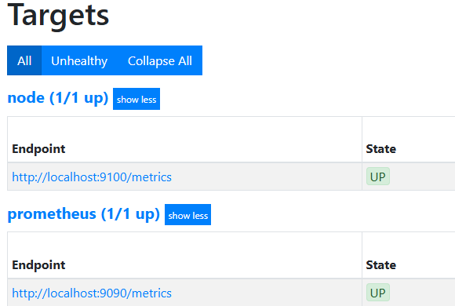
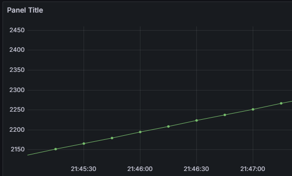
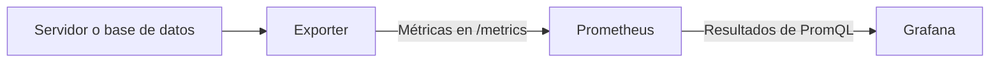

# Prometheus y Grafana

Estas prácticas de monitorización, preparadas por Manuel Domínguez, cubren la instalación de Prometheus y Grafana, la supervisión de servidores y bases de datos, las consultas PromQL y la creación de alertas.

## Prometheus

Prometheus recoge métricas de sistemas y servicios a intervalos regulares. Las almacena como series temporales, identificadas por el nombre de la métrica y un conjunto de etiquetas. Con **PromQL** puedes filtrar por servidor, agregar series y calcular tasas de cambio.

Un **target** es un objetivo de monitorización configurado en Prometheus. Prometheus consulta su **endpoint** HTTP para obtener las métricas. En la configuración, un **job** agrupa objetivos que cumplen una función común. La etiqueta **instance** identifica cada objetivo y, por defecto, toma su dirección y puerto.

## Exporters

Un **exporter** obtiene métricas de un sistema o servicio y las expone en un formato que Prometheus puede recoger, habitualmente en la ruta `/metrics`. En estas prácticas se usan dos exporters:

- **Node Exporter** expone métricas del equipo, como CPU, memoria, disco y red.
- **MySQL Exporter** recoge métricas de MySQL y MariaDB, como el número de conexiones y los comandos ejecutados.

## Grafana

Grafana usa Prometheus como fuente de datos. Envía consultas PromQL y muestra los resultados en paneles que se agrupan en dashboards. También permite definir reglas de alerta y enviar notificaciones si una métrica cumple una condición.

## Flujo de las métricas

Prometheus recoge las métricas que publica el exporter. Grafana consulta esas series mediante PromQL para dibujar los paneles.

## Prácticas

1. [Instalación de Prometheus y Node Exporter](practica-01-instalacion-prometheus.md)
2. [Instalación de Grafana](practica-02-instalacion-grafana.md)
3. [Conexión de Grafana con Prometheus y creación de un dashboard](practica-03-prometheus-en-grafana.md)
4. [Monitorización de servidores remotos](practica-04-servidores-remotos.md)
5. [Pruebas de carga en el servidor](practica-05-carga-del-servidor.md)
6. [Consultas PromQL y creación de un dashboard](practica-06-consultas-promql.md)
7. [Creación de alertas](practica-07-alertas.md)
8. [Monitorización de MariaDB](practica-08-mariadb.md)

El [anexo de configuración YAML](anexo-yaml.md) contiene ejemplos para editar los archivos de configuración de Prometheus. Las capturas de las prácticas se guardan en [img/](img/).

## Documentación oficial

- [Primeros pasos con Prometheus](https://prometheus.io/docs/introduction/first_steps/)
- [Exporters e integraciones de Prometheus](https://prometheus.io/docs/instrumenting/exporters/)
- [Documentación de Grafana](https://grafana.com/docs/grafana/latest/)
