# Práctica 01 · Instalación de Prometheus

[Volver al índice](README.md)

## 1.- Actualizar el sistema

Primero, asegúrate de tener todo al día:

~~~bash
sudo apt update && sudo apt upgrade -y
~~~

## 2. Instalar Prometheus y Node Exporter

~~~bash
sudo apt install prometheus prometheus-node-exporter
~~~

## 3.- Verificar la instalación

Comprobamos que ambos servicios están activos:

Prometheus:

~~~bash
systemctl status prometheus
systemctl is-enabled prometheus
~~~

Node-exporter

~~~bash
systemctl status prometheus-node-exporter
~~~

## 4.-Archivos de configuración:

/etc/prometheus/prometheus.yml

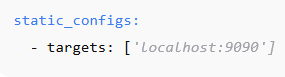

Significa que Prometheus está intentando scrape (recoger métricas) desde sí mismo.

………………..

Es el módulo de node-exporter.

Indica por el puerto que node-exporter está mostrando sus métricas.

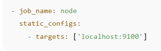

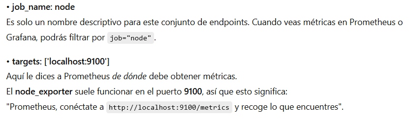

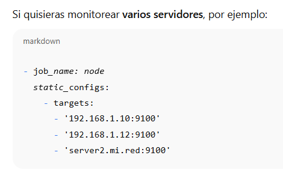

/etc/default/prometheus

~~~ini
# Set the command-line arguments to pass to the server. # Due to shell escaping, to pass backslashes for regexes, you need to double # them (\\d for \d). If running under systemd, you need to double them again # (\\\\d to mean \d), and escape newlines too.
ARGS=""
~~~

Eso significa que Prometheus se está ejecutando solo con su configuración por defecto, tomando el archivo /etc/prometheus/prometheus.yml y ya.

Si quisieras que Prometheus haga algo extra, aquí es donde agregarías las opciones. Por ejemplo:

- Para cambiar el puerto donde escucha (por defecto es 9090):

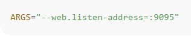

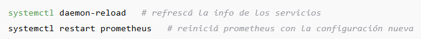

## 5.- Acceso a Prometheus

IP:9090

Target=host:puerto. Es una dirección que expone métricas

Status  Targets (Son los exporters conectados)

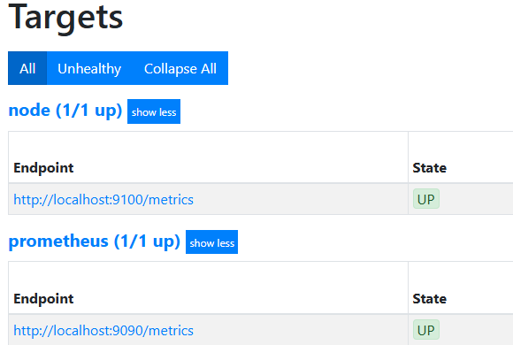

Una consulta: node_cpu_seconds_total

| 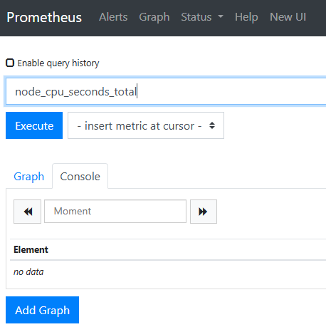 | Es una métrica expuesta por node_exporter que representa la cantidad de tiempo que cada CPU ha pasado en diferentes modos, medida en segundos acumulados. No es “uso de CPU” directamente, sino un contador que siempre sube. |
| --- | --- |

## 6.- Acceso a Prometheus-Node-Exporter

IP:9100

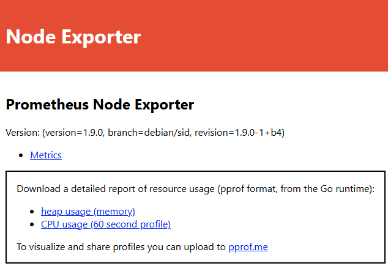

Acceso a Metrics: Vemos todas las métricas que está recogiendo.

## 7.-Verificar puertos

| 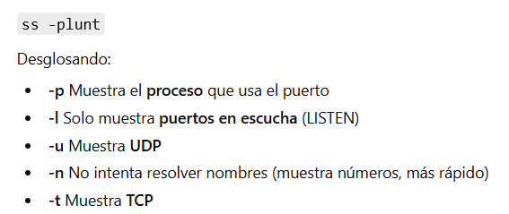 | 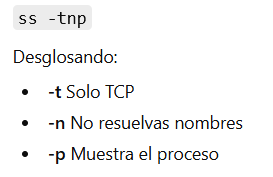 |
| --- | --- |
| Muéstrame todos los sockets en escucha, tanto TCP como UDP, con el proceso que los está usando. | Muéstrame las conexiones TCP activas y en uso, mostrando qué proceso las está usando |
