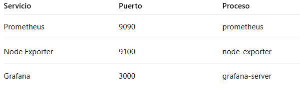
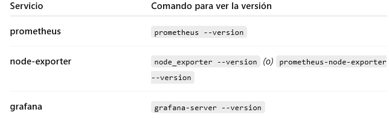

# Práctica 02 · Instalación de Grafana

[Volver al índice](README.md)

## 1. Instalar Grafana OSS

En Debian o Ubuntu, instala las dependencias e importa la clave del repositorio oficial.

~~~bash
sudo apt update
sudo apt install -y apt-transport-https wget gnupg
sudo install -d -m 755 /etc/apt/keyrings
sudo wget -O /etc/apt/keyrings/grafana.asc https://apt.grafana.com/gpg-full.key
sudo chmod 644 /etc/apt/keyrings/grafana.asc
~~~

Añade el repositorio estable, instala Grafana e inicia el servicio.

~~~bash
echo "deb [signed-by=/etc/apt/keyrings/grafana.asc] https://apt.grafana.com stable main" | sudo tee /etc/apt/sources.list.d/grafana.list
sudo apt update
sudo apt install -y grafana
sudo systemctl enable --now grafana-server
systemctl status grafana-server
~~~

[Guía oficial de instalación en Debian o Ubuntu](https://grafana.com/docs/grafana/latest/setup-grafana/installation/debian/)

## 2.- Acceso a Grafana

IP:3000

|  | Por defecto: admin (admin)  La cambiamos. |
| --- | --- |

## 3.- Configuración de Grafana

/etc/grafana/grafana.ini

| Línea 48: Puerto por defecto # The http port to use ;http_port = 3000 | Línea 129:Base de datos por defecto ;type = sqlite3 ;host = 127.0.0.1:3306 ;name = grafana ;user = root |
| --- | --- |
| ; significa “esto es un valor por defecto documentado: si no lo cambio, se usa ese valor”. Si querés que Grafana escuche en el puerto 4000, lo dejás así: http_port = 4000 | Se encuentra en: /var/lib/grafana/grafana.db   (SQLite) |

## 4.- Comprobaciones de puertos

ss –plunt

## 5.- Versiones instaladas

