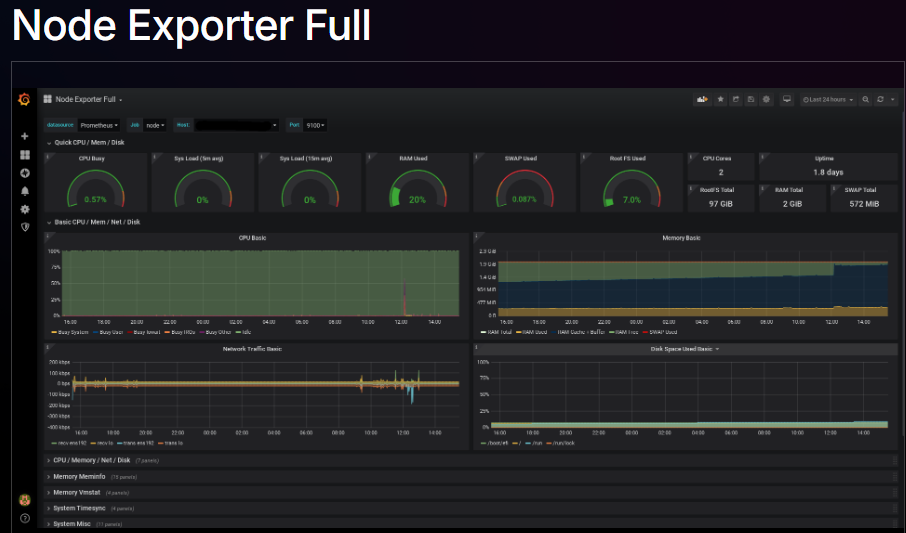
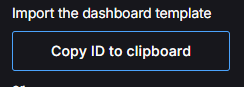
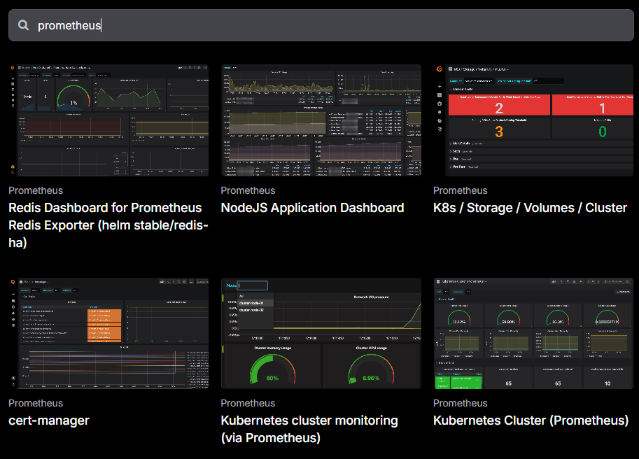
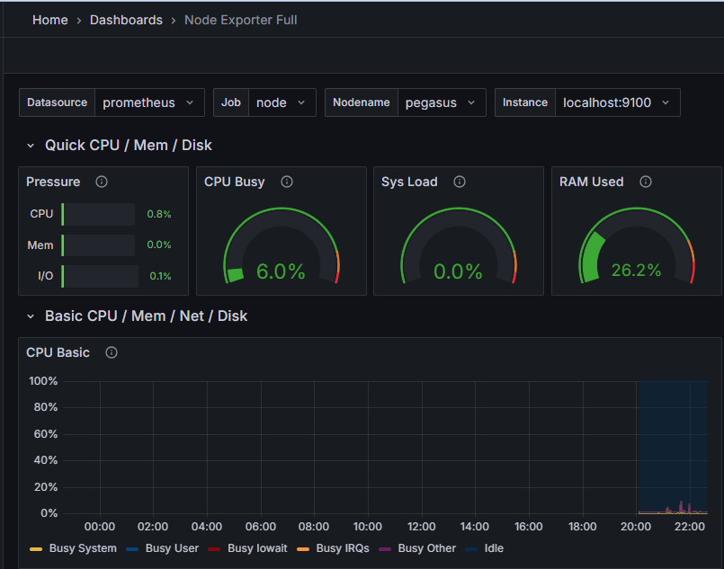
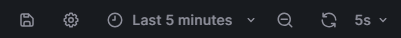
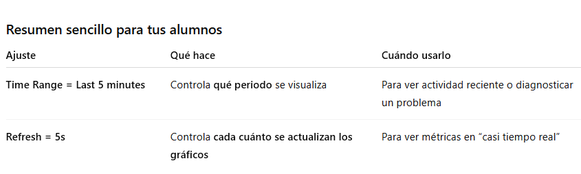

# Práctica 03 · Conexión de Grafana con Prometheus y creación de un dashboard

[Volver al índice](README.md)

NOTA IMPORTANTE:Recordemos que: Prometheus, Promewtheus-Node-Exporter, y Grafana están instalados en el mismo equipo: 192.168.0.50

## 1.-Añadir Prometheus como Data Source

#### 1. Acceder a Grafana

Abrir navegador:

http://192.168.0.50:3000

Usuario: admin Contraseña: admin (cambiar en el primer acceso)

#### 2. Añadir Prometheus como Data Source

- En el menú de Grafana, ir a Connections.
- Seleccionar Data Sources.
- Pulsar Add data source.
- Buscar y elegir Prometheus.
- En el campo URL, escribir:

http://192.168.0.50:9090

- Bajar y pulsar Save & Test. Debe aparecer el mensaje: Data source is working.

## 2.-Ver Dashboards existentes

## 1.- Accede a:

https://grafana.com/grafana/dashboards/

## 2.- Buscamos los que ponga Prometheus: Node Exporter Full

|  | Copiamos su identificador:      1860 |
| --- | --- |

Otros Dashboards:

## 3.-Importar un Dashboard completo

Dashboard

Create DashBoard

Import Dashboard

Me pregunta: (Por qué no tengo nada creado)

Unsaved changes Do you want to save your changes? Le digo No

Y ahora copio el ID y le doy a Import

## 2.-Refresh Dashboard

## 1.- Actualizar el Absolute time range a: Last 5 minutes

## 2.- Refresh Dashboard:5s

## 3.- Podemos hacer un ping continuo en el servidor. Ping google.es, y vemos Network Traffic Fifo.
