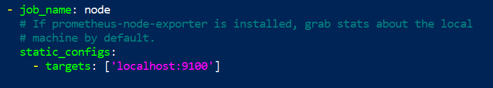
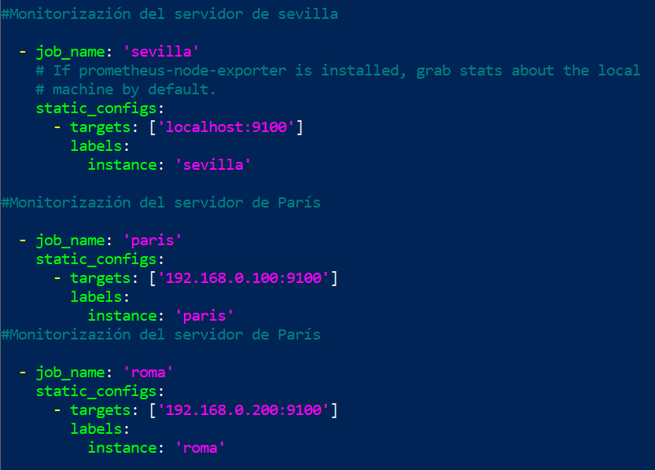
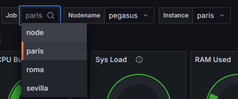

# Práctica 04 · Monitorización de servidores remotos

[Volver al índice](README.md)

Eres uno de los administradores de la empresa RC DevOps. La compañía ha contratado dos servidores Linux (Debian sin entorno gráfico) ubicados en París y Roma, y tu tarea es configurarlos para que puedan ser monitorizados de manera centralizada.

El objetivo es obtener información en tiempo real sobre los parámetros fundamentales del sistema:

- CPU
- Memoria RAM
- Almacenamiento (disco)
- Red (ancho de banda y tráfico)

Todas las métricas deben enviarse a un servidor central situado en Sevilla, donde estarán instalados Prometheus (para recopilar y almacenar datos) y Grafana (para visualizar los resultados en paneles gráficos).

Tu misión consiste en:

- Configurar cada servidor remoto (París y Roma) para que exponga sus métricas mediante un exporter adecuado.
- Registrar las métricas de cada servidor en Prometheus, identificándolos claramente con el nombre de su ciudad.
- Verificar desde Grafana (servidor en Sevilla) que ambos equipos aparecen correctamente monitorizados y que muestran los valores de CPU, RAM, Disco y Red.

En resumen, deberás implementar una solución completa de monitorización en la que el servidor de Sevilla centraliza todos los datos enviados por los servidores de París y Roma, permitiendo visualizar el estado de cada uno mediante paneles gráficos.

Procedimiento:

## 1.- Instalamos solamente el exporter en los servidores.

prometheus-node-exporter

## 2.- En el cliente, instalamos prometheus y lo vamos a configurar.

~~~text
Incialmente
~~~

Node  es el nombre que le da Prometheus a Prometheus-node-exporter
En lugar de poner localhost:9100, deberíamos poner donde está el node-exporter. Pero al tenerlo todo instalado en el mismo equipo, ponemos localhost

NOTA: Leer al final la diferencia entre job_name y instance

## 3.- Reiniciamos Prometheus. No hace reiniciar Grafana.

## 4.- No tenemos que configurar nada en Grafana, porque el lee de prometheus, que no hemos cambiado nada.

Ya podemos visualizar los distintos servidores.

NOTA: Leer al final la diferencia entre job_name y instance

Aquí tienes la diferencia clara, directa y fácil de recordar entre job_name e instance:

## 🟦 1. job_name → NOMBRE DEL GRUPO

El job_name sirve para identificar el conjunto de targets que pertenecen a la misma tarea de scraping.

👉 Es el nombre del trabajo que hace Prometheus.
👉 No identifica a un servidor concreto.

Ejemplo:

~~~yaml
job_name: 'paris'
~~~

Esto solo dice que este bloque se llama “paris”.

## 🟩 2. labels.instance → NOMBRE DEL SERVIDOR

La etiqueta instance identifica al servidor individual dentro del job.

👉 Es el nombre del host que verás en Grafana.
👉 Sustituye a la IP y hace que los gráficos sean más legibles.

Ejemplo:

~~~yaml
labels:
  instance: 'paris'
~~~

Esto le dice a Prometheus:
“Etiqueta todas las métricas de este servidor como instance="paris"”.

## 🟧 Diferencia resumida en una frase

🔹 job_name = nombre del grupo de scraping
🔹 instance = nombre del servidor concreto dentro del grupo

## 🎯 EJEMPLO FINAL QUE LO ACLARA TODO

~~~yaml
- job_name: 'paris'
  static_configs:
    - targets: ['192.168.0.100:9100']
      labels:
        instance: 'paris'
~~~

- job_name = paris → nombre del job
- instance = paris → nombre del servidor

Aunque coincidan, no son lo mismo.

## Anexo sobre job_name e instance

Fichero: prometheus.yaml

La diferencia clara, directa y fácil de recordar entre job_name e instance:

### 🟦 1. job_name → NOMBRE DEL GRUPO

El job_name sirve para identificar el conjunto de targets que pertenecen a la misma tarea de scraping.

👉 Es el nombre del trabajo que hace Prometheus.
👉 No identifica a un servidor concreto.

Ejemplo:

~~~yaml
job_name: 'paris'
~~~

Esto solo dice que este bloque se llama “paris”.

### 🟩 2. labels.instance → NOMBRE DEL SERVIDOR

La etiqueta instance identifica al servidor individual dentro del job.

👉 Es el nombre del host que verás en Grafana.
👉 Sustituye a la IP y hace que los gráficos sean más legibles.

Ejemplo:

~~~yaml
labels:
  instance: 'paris'
~~~

Esto le dice a Prometheus:
“Etiqueta todas las métricas de este servidor como instance="paris"”.

### 🟧 Diferencia resumida en una frase

🔹 job_name = nombre del grupo de scraping
🔹 instance = nombre del servidor concreto dentro del grupo

### 🎯 EJEMPLO FINAL QUE LO ACLARA TODO

~~~yaml
- job_name: 'paris'
  static_configs:
    - targets: ['192.168.0.100:9100']
      labels:
        instance: 'paris'
~~~

- job_name = paris → nombre del job
- instance = paris → nombre del servidor

Aunque coincidan, no son lo mismo.
