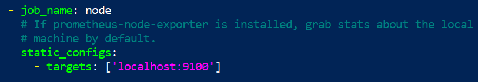

# Práctica 05 · Pruebas de carga en el servidor

[Volver al índice](README.md)

## 1.-Comprobaciones previas

Partimos de un servidor que tiene instalado Prometheus, prometheus-Node-Exporter y Grafana.

Desde el terminal:

~~~bash
systemctl status prometheus
~~~

status prometheus-node-exporter

~~~bash
systemctl status grafana-server.service
~~~

Ficheros de configuración:

/etc/prometheus/prometheus.yml

El node-exporter está instalado en la misma máquina de Prometheus.

Desde el navegador:

Prometheus: http://192.168.0.50:9090

Prometheus-Node-Exporter: http://192.168.0.50:9100

Grafana: [http://192.168.0.50:3000](http://192.168.0.50:3000)

Aquí configuramos Datasource con Prometheus y le ponemos la IP donde se encuentra Prometheus.

Dashboards: Node Exporter Full

## 1.- Actualizar el Absolute time range a: Last 5 minutes

## 2.- Refresh Dashboard:5s

## 2.- El comando stress

~~~bash
stress-ng es la versión "Next Generation" de la herramienta stress.
apt update
apt install stress-ng
~~~

## 3.- Estresamos la memoria RAM

~~~bash
stress-ng --vm 1 --vm-bytes 1200M --vm-hang 0 --timeout 120s
~~~

Desglose del comando (¿Por qué funciona este y el otro no?):

--vm 1: Inicia 1 proceso.

--vm-bytes 1200M: Le dice que reserve exactamente 1200 MB.

--vm-hang 0 (LA CLAVE): Esta opción le dice al proceso: "Asigna la memoria y duérmete (hang) manteniendo la memoria secuestrada hasta que termine el tiempo".
- Sin esto: El proceso entra en bucle asignando/liberando, disparando la CPU.
- Con esto: El proceso asigna la RAM una vez y se queda quieto. Verás la CPU baja y la RAM estática en 1.2GB.

--timeout 120s: Mantiene la prueba 2 minutos, tiempo suficiente para que Grafana dibuje la gráfica con claridad.

## 4.- Vamos a estresar la CPU

## 1.- Averiguamos cuántos núcleos tiene nuestra cpu.

nproc  Me ha devuelto 1.

## 2.- Lo estresamos:

~~~bash
stress-ng --cpu $(nproc) --timeout 60s
~~~

--cpu $(nproc): Esto le dice a stress-ng: "Arranca el estresor de CPU genérico (matrix, cálculos flotantes, etc.) y crea exactamente tantos procesos como número me ha dado el comando nproc".

Sincronización: Al haber 1 proceso por cada núcleo, no hay "cola de espera". Cada núcleo está ocupado al 100% atendiendo a su trabajador asignado.

## 5.- Vamos a crear el disco duro

~~~bash
sudo stress-ng --hdd 1 --hdd-bytes 2G --timeout 60s
~~~

| Opción | Qué hace |
| --- | --- |
| --hdd 1 | Crea 1 proceso que realiza operaciones de disco (lectura, escritura, sync). |
| --hdd-bytes 2G | El proceso escribirá hasta 2 GB de datos en archivos temporales. |
| --timeout 60s | Ejecuta el estrés durante 60 segundos. |

IOPs	Cantidad de operaciones	"Lee 2000 bloques/seg"

Throughput	Cantidad de datos	“Lee 800 MB/s”

## 6.- Vamos a crear la red

## 1.- Estresar internamente la máquina:

~~~bash
sudo stress-ng --netdev 1 --timeout 60s
~~~

--netdev	Estresa internamente la interfaz de red y su driver

No genera MB/s	No hay tráfico entre máquinas

Genera muchos paquetes.  Network Traffic by Packets

| Métrica | ¿Por qué sube con --netdev? |
| --- | --- |
| Network Traffic | Porque hay muchos paquetes internos en la pila TCP/IP |
| Network Saturation | Porque suben los softIRQ, colas de red, interrupciones, drops |
| MB/s reales | No suben, porque no hay tráfico real |

## 2.- Estresar la red entre dos máquinas

| Servidor | Cliente |
| --- | --- |
| iperf3 –s | iperf3 -c IP_DEL_SERVIDOR |
| Este comando: Pone la máquina en modo servidor Escucha en el puerto TCP 5201 Espera a que otro equipo (cliente) le envíe tráfico No genera tráfico por sí mismo Cuando un cliente se conecta, mide la velocidad real de la red entre ambos equipos: Mbps o Gbps Transferencia total Estabilidad del enlace ➡️ Es la forma profesional de saturar la red y ver en Grafana: Throughput, RX/TX MB/s, saturación real, latencia |  Lo hay para Windows y para Linux. |
