# Práctica 06 · Consultas PromQL y creación de un dashboard

[Volver al índice](README.md)

## Lenguaje de consulta de Prometheus

PromQL (Prometheus Query Language) es el lenguaje de consulta utilizado para trabajar con las series temporales almacenadas en Prometheus. Permite filtrar métricas mediante etiquetas, realizar agregaciones (promedios, sumas, máximos, mínimos), calcular tasas de cambio, combinar series entre sí y aplicar funciones avanzadas para analizar el comportamiento de los sistemas monitorizados.

Además de usarse directamente en Prometheus, PromQL también se puede ejecutar desde Grafana, ya que Grafana envía las consultas a Prometheus como datasource. Esto permite visualizar los resultados de PromQL en paneles, gráficos, estadísticas, reglas de alerta y en el modo Explore, facilitando la construcción de dashboards interactivos y sistemas de monitoreo completos.

## Enunciado

#### Crear, probar y compartir un dashboard en Grafana

##### 1. Crea un Dashboard personalizado

Crea un nuevo dashboard en Grafana con el nombre:

Mi Dashboard – TuNombre

Dentro de este dashboard, crea 4 paneles, cada uno con un título descriptivo y una consulta PromQL que:

- CPU
Muestra el porcentaje de uso de CPU del sistema en los últimos minutos.

- Memoria (RAM)
Calcula y muestra el porcentaje de memoria libre en el sistema.

- Disco
Ver actividad de disco (escritura por segundo)

- Red
Calcula la tasa de bytes recibidos en la interfaz de red principal en el último minuto.

##### 2. Estresa el sistema

Realiza alguna acción para estresar el sistema y observa los paneles

##### 3. Exporta y comparte tu dashboard

- Exporta tu dashboard a un archivo JSON.
- Borra el Dashboard creado.
- Importa tu dashboard en su Grafana y comprobar que:
- Ve los mismos 4 paneles.
- Las consultas funcionan correctamente en su entorno.

## Creación de un dashboard

### 0.-Comprobaciones previas

Partimos de un servidor que tiene instalado Prometheus, prometheus-Node-Exporter y Grafana.

Desde el terminal:

~~~bash
systemctl status prometheus
~~~

status prometheus-node-exporter

~~~bash
systemctl status grafana-server.service
~~~

Ficheros de configuración:

/etc/prometheus/prometheus.yml

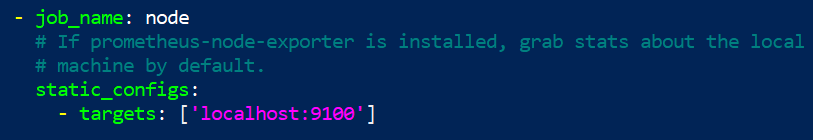

El node-exporter está instalado en la misma máquina de Prometheus.

Desde el navegador:

Prometheus: http://192.168.0.50:9090

Prometheus-Node-Exporter: http://192.168.0.50:9100

Grafana: [http://192.168.0.50:3000](http://192.168.0.50:3000)

Aquí configuramos Datasource con Prometheus y le ponemos la IP donde se encuentra Prometheus.

### 1.-PromQL

~~~text

PromQL (Prometheus Query Language) es el lenguaje de consulta utilizado para trabajar con las series temporales almacenadas en Prometheus. Permite filtrar métricas mediante etiquetas, realizar agregaciones (promedios, sumas, máximos, mínimos), calcular tasas de cambio, combinar series entre sí y aplicar funciones avanzadas para analizar el comportamiento de los sistemas monitorizados.

Además de usarse directamente en Prometheus, PromQL también se puede ejecutar desde Grafana, ya que Grafana envía las consultas a Prometheus como datasource. Esto permite visualizar los resultados de PromQL en paneles, gráficos, estadísticas, reglas de alerta y en el modo Explore, facilitando la construcción de dashboards interactivos y sistemas de monitoreo completos.
~~~

~~~text
2.- Consultas en Prometheus
~~~

### 1.- Abrimos prometheus: http://IP:9090

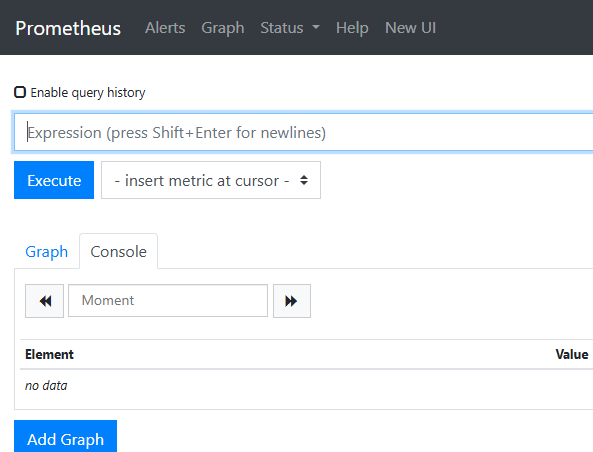

### 2.- Escribimos la consulta y la ejecutamos.

Ejemplo: node_cpu_seconds_total

Tiempo acumulado que cada CPU ha pasado en distintos modos (idle, user, system, iowait, etc.).

Idle: Filtra la métrica para mostrar solo el tiempo que la CPU ha pasado sin hacer trabajo.

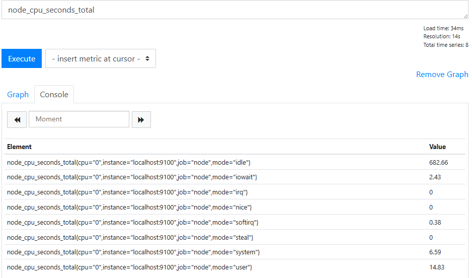

También podemos verlo en forma gráfico: Graph

~~~text
3.- Dashboard nuevo. Consultas en Grafana
~~~

Consulta: El tiempo que lleva la CPU sin uso desde que se arrancó.

### 1.- Creamos un nuevo Dashboard para realizar las consultas.

Mi Dashboard

Dashboard_New

### 2.- Añadimos un nuevo panel: + Add visualization

### 3.- Seleccionamos Prometheus como Data Source:

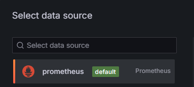

### 4.- Escribimos la consulta (code) y Pulsamos sobre: Run queries

node_cpu_seconds_total{mode="idle"}

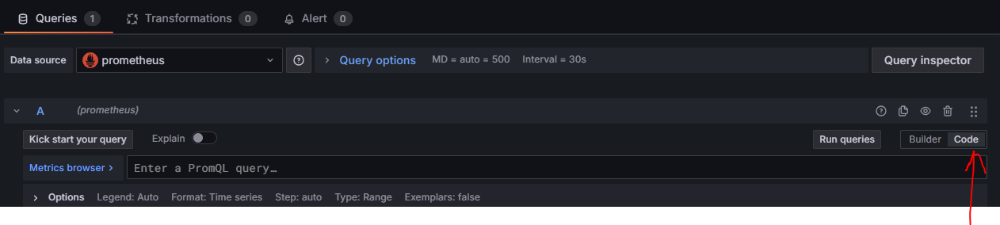

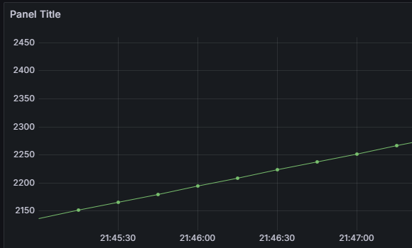

### 5.- Podemos cambiar las líneas del gráfico por otro.

|     | 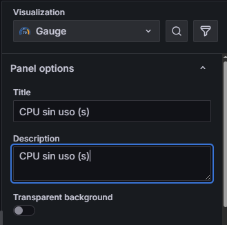 |
| --- | --- |

### 6.- Titulo al panel: CPU sin uso(s)

### 7.- Save dashboard:

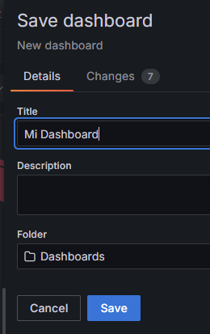

~~~text
4.- Copiando las consultas de Dashboard: Node Exporter Full
~~~

Vamos a copiar una consulta de Node Exporter Full y la vamos a llevar a nuestro Dashboard nuevo: “Mi Dashboard”

### 1.- Podemos copiar las consultas creadas por Node Exporter Full

### 2.- Accedemos a la consulta que nos interesa y en la parte superior derecha, elegimos Inspect:Query (Refresh)

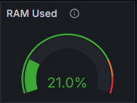

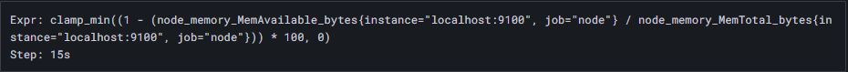

Devuelve el porcentaje de memoria usada en el sistema, asegurándose de que nunca salga un valor negativo.

Nota:  clamp_min(valor, 0) Esto asegura:

👉 Si el cálculo da un valor negativo, se fuerza a 0.

FALLA si la copiamos tal como está.

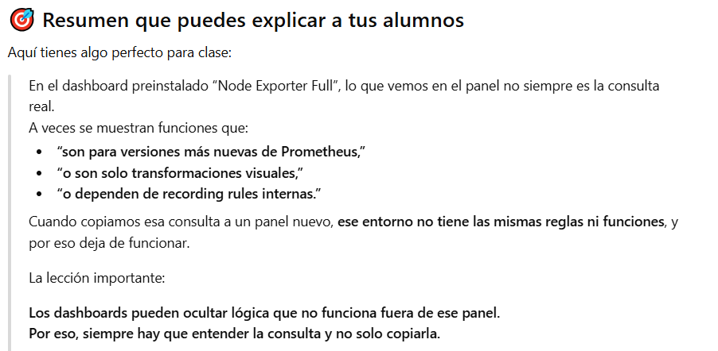

La modificamos:

(1 - (node_memory_MemAvailable_bytes{instance="localhost:9100", job="node"}

/ node_memory_MemTotal_bytes{instance="localhost:9100", job="node"})) * 100

### 3.- Podemos crear una nueva consulta en nuestro panel adaptando ésta.

Add-Visualization  Memoria usada

~~~text
5.- Copiando Dashboard Node Exporter Full
~~~

### Copiar el dashboard y quedarte solo con las métricas que te interesan

##### 1.-Abrir el dashboard original (Node Exporter Full)

##### 2.- Hacer un “Save As…”

##### Esto crea una copia completamente editable, sin restricciones.

Dashboard básico

##### 3.- Nos vamos a quedar solo con:

Quick CPU / Mem / Disk

##### Basic CPU / Mem / Net / Disk

### 4.- Borramos el resto de los paneles.

Para borrar los paneles hay que activar el modo EDITAR.

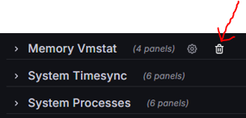

~~~text
6.- Ejercicios: Dashboard Personalizado
~~~

##### Crear, probar y compartir un dashboard en Grafana

###### 1. Crea un Dashboard personalizado

Crea un nuevo dashboard en Grafana con el nombre:

Mi Dashboard – TuNombre

Dentro de este dashboard, crea 4 paneles, cada uno con un título descriptivo y una consulta PromQL que:

- CPU
Muestra el porcentaje de uso de CPU del sistema en los últimos minutos.

- Memoria (RAM)
Calcula y muestra el porcentaje de memoria libre en el sistema.

- Disco
Ver actividad de disco (escritura por segundo)

- Red
Calcula la tasa de bytes recibidos en la interfaz de red principal en el último minuto.

###### 2. Estresa el sistema

Realiza alguna acción para estresar el sistema y observa los paneles

###### 3. Exporta y comparte tu dashboard

- Exporta tu dashboard a un archivo JSON.
- Borra el Dashboard creado.
- Importa tu dashboard en su Grafana y comprobar que:
- Ve los mismos 4 paneles.
- Las consultas funcionan correctamente en su entorno.

##### CPU

~~~text
100 * (1 - avg(rate(node_cpu_seconds_total{mode="idle"}[5m])))
~~~

##### Memoria (RAM)

~~~text
100 * (node_memory_MemAvailable_bytes / node_memory_MemTotal_bytes)
~~~

##### Disco (actividad)

~~~text
rate(node_disk_written_bytes_total[1m])
~~~

##### Red

~~~text
rate(node_network_receive_bytes_total{device!="lo"}[1m])
~~~

Script:

#!/bin/bash

# Estrés CPU (todos los cores)

~~~bash
stress-ng --cpu 0 --timeout 120 >/dev/null 2>&1
~~~

# Estrés RAM (1 GB)

~~~bash
stress-ng --vm 1 --vm-bytes 1G --timeout 120 >/dev/null 2>&1
~~~

# Estrés Disco (actividad de escritura real)

~~~bash
stress-ng --hdd 1 --hdd-bytes 2G --timeout 120 >/dev/null 2>&1
~~~

# Estrés Red (descargar ISO de Proxmox)

~~~bash
wget -q https://download.proxmox.com/iso/proxmox-ve_8.1-2.iso -O /tmp/proxmox.iso >/dev/null 2>&1
~~~
