# Práctica 07 · Creación de alertas

[Volver al índice](README.md)

## 0.-Comprobaciones previas

Partimos de un servidor que tiene instalado Prometheus, prometheus-Node-Exporter y Grafana.

Desde el terminal:

~~~bash
systemctl status prometheus
~~~

status prometheus-node-exporter

~~~bash
systemctl status grafana-server.service
~~~

Ficheros de configuración:

/etc/prometheus/prometheus.yml

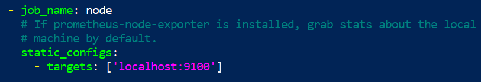

El node-exporter está instalado en la misma máquina de Prometheus.

Desde el navegador:

Prometheus: http://192.168.0.50:9090

Prometheus-Node-Exporter: http://192.168.0.50:9100

Grafana: [http://192.168.0.50:3000](http://192.168.0.50:3000)

Aquí configuramos Datasource con Prometheus y le ponemos la IP donde se encuentra Prometheus.

## 1.-Alertas con gmail

## 1.- Accede a la cuenta de google.

## 2.- Seguridad e Inicio de sesión.

## 3.- Activar la verificación en dos pasos

## 4.- Volvemos a la cuenta de google.

Buscamos: contraseñas de aplicación (Está en Datos y privacidad)

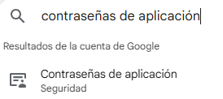

## 5.- Creamos una contraseña:

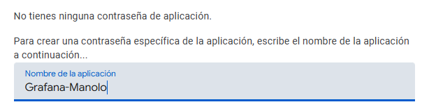

## 6.- Guardamos la contraseña en lugar seguro.

~~~text
2.- Obtener los datos de nuestro servidor de correo
~~~

## SMTP Gmail

- Host: smtp.gmail.com
- Puerto: 587
- Usuario: tu correo Gmail
- Contraseña: contraseña de aplicación
- TLS: sí

~~~text
3.- Configuración de /etc/grafana/grafana.ini
~~~

## 1.- Hacemos una copia de /etc/grafana/grafana.ini

Grafana envía un correo con los datos, y el servidor SMTP lo recibe y lo envía al destinatario.

El servidor SMTP actúa como el buzón de correos.

Grafana → envía el correo → SMTP Gmail → entrega el correo al destinatario

## 2.- Modificamos el fichero. Línea 1083

| [smtp] enabled = true host = smtp.gmail.com:587 user = Tucorreo@gmail.com password = Tu passsword (16 caracteres sin espacio) ;cert_file = ;key_file = skip_verify = yes from_address = Tucorreo@gmail.com from_name = Grafana | user : Es el usuario con el que Grafana se autentica en Gmail. Es el correo y la contraseña que utilizará Grafana para entrar en Gmail  Password:  Esta es la contraseña de aplicación que creaste en Google.  kip_verify = yes Le dice a Grafana que NO verifique los certificados TLS del servidor SMTP.  from_address: Dirección que aparecerá como remitente en los emails enviados. |
| --- | --- |

*Es conveniente que user y from_address sea el mismo.

Reiniciamos el servicio:

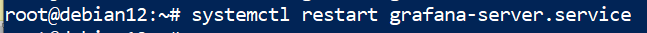

~~~text
4.- GRAFANA: Crear un canal de comunicación: Contact Points
~~~

[http://IP:3000](http://IP:3000)

Vamos a configurar cómo se va a enviar las notificaciones

## 1.- Home_Alerting

Contact points

Creamos uno nuevo. Si pulsamos Integration, podemos ver con servicios se integra Grafana: Email, Microsoft Teams, Telegram, etc.

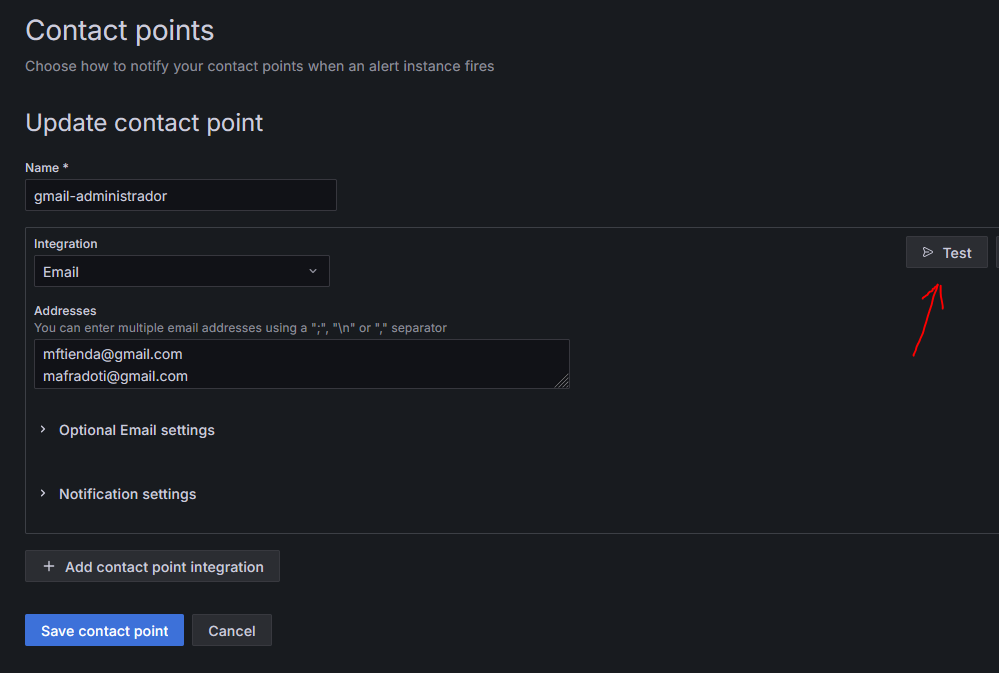

Addresses: son los correos a los que les va a llegar la notificación.

Test

Una vez testeado, Save contact point

Abrimos nuestro correo en Gmail.com

~~~text
5.- CREACIÓN DE ALERTA PARA MEDIR EL USO DE LA MEMORIA RAM
~~~

Si la memoria RAM disponible es menor que una cantidad que salte una alarma.

Home_Alerting_Alert rules_New alert rule

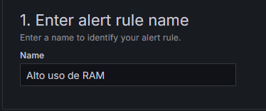

Introducimos la métrica: node_memory_MemAvailable_bytes / 1024^2

Devuelve la cantidad total de memoria RAM disponible en el sistema en bytes. Lo dividimos por 1024 ^2 para que nos dé en MiB.

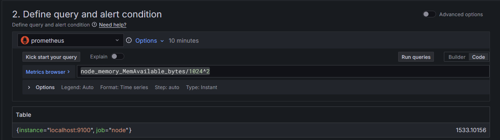

Podemos darle a Run queries para comprobar que la consulta funciona

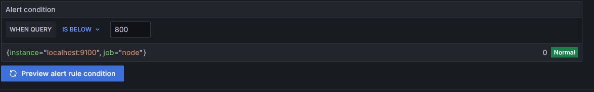

Is below 800

Si la memoria disponible baja de 800 MiB → se dispara la alerta

Debe salir: 

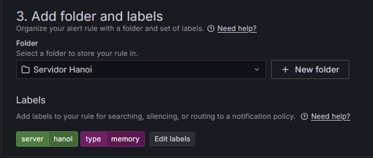

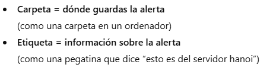

Vamos a crear una carpeta llamada: Servidor Hanoi y después dos etiquetas para describir la alerta: server=hanoi y type=memory

Para que acepte la etiqueta pulsamos ENTER

Este apartado controla cómo y cuándo Grafana decide que la alerta debe activarse.

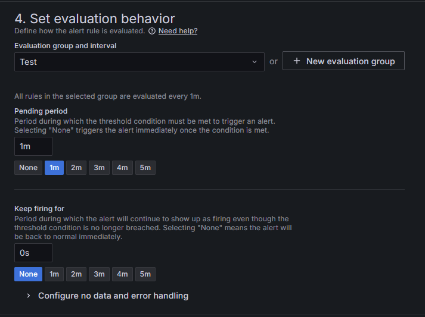

## 1.- Evaluation group: Test (grupo nuevo)

Aquí elegimos cada cuánto tiempo se comprueba la condición.

1 minuto

## ¿Qué es un Evaluation Group en Grafana?

Es un grupo de alertas que se evalúan todas juntas en el mismo intervalo.

👉 Si varias alertas usan el mismo evaluation group, entonces todas se evalúan al mismo tiempo (cada 1 minuto, por ejemplo).

## 2.- Pending period: 1 minuto

## Pending period

Es el tiempo que la condición debe mantenerse cumplida antes de que la alerta dispare.

## 3.- Keep firing for: 0

## Keep firing for

Es el tiempo durante el cual la alerta sigue apareciendo como activa aunque la condición haya vuelto a la normalidad.

👉 “Aunque la memoria vuelva a estar bien, mantén la alerta activa durante X tiempo más.”

#### Ejemplo:

Si pones 30s o 2m, cuando la RAM vuelve a estar bien:

- La alerta no desaparece inmediatamente
- Se queda “active” durante ese tiempo

#### ✔️ Si pones None / 0s

La alerta desaparece inmediatamente cuando se cumple la condición normal.

RESUMEN:

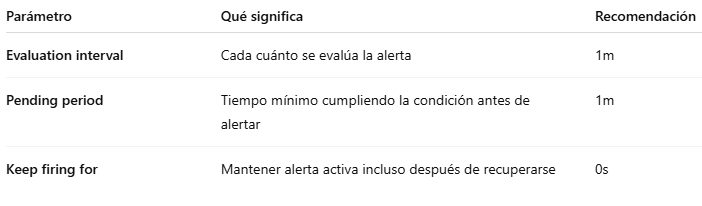

Esta parte es muy importante porque es donde decides a quién se envían las alertas (en tu caso, a tu correo Gmail).

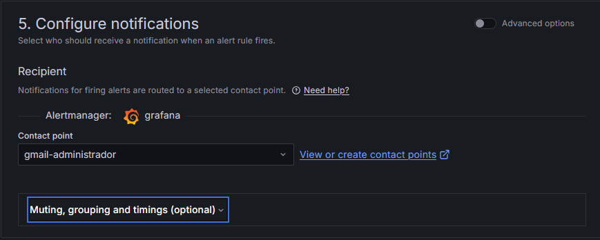

## 1.- Contact point: Gmail-administrador

## Contact point

Este es el campo más importante.

Aquí seleccionas tu contacto SMTP, es decir:

## 2.- Muting, grouping and timings: De momento lo dejamos

## Muting, grouping and timings (optional)

Esto es opcional y sirve para:

- Agrupar alertas por etiquetas
- Evitar que te lleguen demasiados emails
- Hacer silencios programados

Si estás empezando, ignóralo de momento.
No necesitas configurarlo todavía.

Esta parte controla cómo aparecerá el mensaje cuando Grafana te envíe una alerta por correo (o cualquier otro canal).

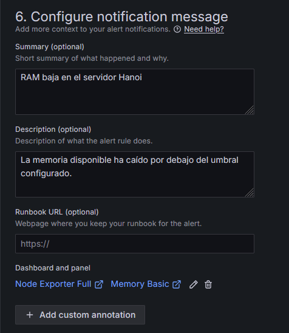

## 1.-Summary: RAM baja en el servidor Hanoi

## Summary (opcional)

👉 Es el título del mensaje de alerta.
Es una frase corta que resume qué ha pasad

## 2.- Description: La memoria disponible ha caído por debajo del umbral configurado.

## Description (opcional)

👉 Es el cuerpo del mensaje, donde explicas qué hace esta alerta o por qué se dispara.

## Runbook URL (opcional)

👉 Es un enlace a una página donde explicas cómo actuar cuando esta alerta salta.
En empresas grandes, se pone un documento con instrucciones para los técnicos.

Si estás enseñando o probando, puedes dejarlo vacío.

O poner algo simple:

~~~text
https://mi-servidor/manual-alertas
~~~

(O nada)

## 4. Botón: Add custom annotation

👉 Sirve para añadir información adicional al panel cuando la alerta se active.

No suele ser necesario al principio.

## 5. Botón: Link dashboard and panel

👉 Esto es MUY útil.

Sirve para que el email de alerta incluya un enlace directo al panel de Grafana donde está la métrica.

Así puedes entrar rápido a ver qué pasa.

Si tienes un dashboard donde aparece la RAM del servidor hanoi, haz clic aquí y enlázalo.

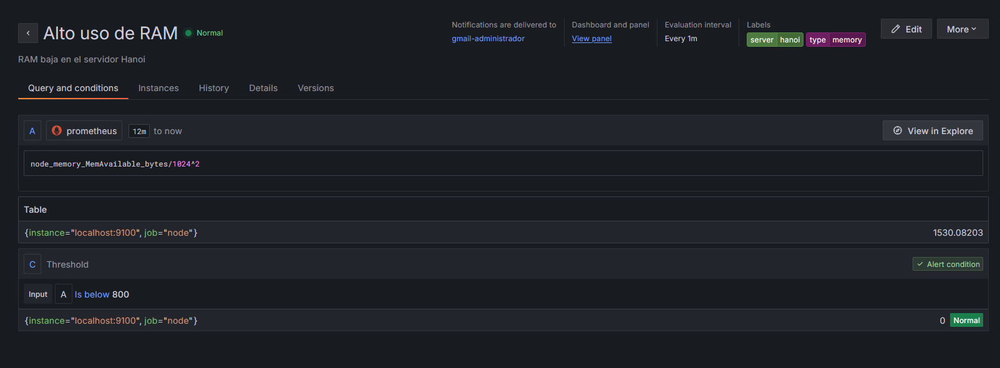

~~~text
6.- ESTRESAMOS A LA MEMORIA RAM
~~~

## 1.- stress-ng --vm 1 --vm-bytes 1500M --timeout 60s

La alerta se va a poner en Pending; es decir, “La alerta se está cumpliendo… pero espero X tiempo antes de dispararla.” Después se va a poner normal.

## 2.- Aumentando el tiempo:

~~~bash
stress-ng --vm 1 --vm-bytes 1500M --timeout 120s
~~~

Pending.Firing-Normal

Miramos el correo:

~~~text
7.- AVANZADO: Hostname
~~~

## 1) Prometheus ya recoge el hostname como etiqueta

Node Exporter expone la métrica con etiquetas como:

~~~text
instance="hanoi:9100"
~~~

O a veces:

~~~text
instance="192.168.0.50:9100"
~~~

Si configuraste Node Exporter con --collector.systemd o usando el fichero /etc/node_exporter, también puede salir:

~~~text
nodename="hanoi"
~~~

Pero lo habitual es tener instance.

## 2) Incluir el hostname en la alerta (fácil)

Cuando escribes el mensaje de alerta en el apartado 6. Configure notification message, puedes usar etiquetas de la propia alerta o etiquetas de las métricas.

Solo tienes que escribir algo como:

#### ✔️ En Summary:

~~~text
Alerta de memoria baja en {{ $labels.instance }}
~~~

#### ✔️ En Description:

~~~text
El servidor {{ $labels.instance }} tiene menos de 800 MB de RAM disponible.
~~~

## 3) Resultado del correo

El correo que te llega incluirá algo como:

~~~text
Alerta de memoria baja en hanoi:9100
~~~

~~~text
EJERCICIO:
~~~

Crea una alerta por email, cuando el uso de la CPU en el último minuto sea superior al 70%.

Solución propuesta:

La expresión:

100 - (rate(node_cpu_seconds_total{mode="idle"}[1m]) * 100)

significa:

👉 “Porcentaje de CPU que sí está trabajando en el último minuto.”

Es decir:

- rate(...) → % de CPU en reposo
- * 100 → lo conviertes en porcentaje
- 100 - ... → obtienes el porcentaje de trabajo real

La estresamos:

~~~bash
stress-ng --cpu $(nproc) --timeout 120s
~~~
