# Práctica 08 · Monitorización de MariaDB

[Volver al índice](README.md)

## 0.-Comprobaciones previas

Partimos de un servidor que tiene instalado Prometheus, prometheus-Node-Exporter y Grafana.

Desde el terminal:

~~~bash
systemctl status prometheus
~~~

status prometheus-node-exporter

~~~bash
systemctl status grafana-server.service
~~~

Ficheros de configuración:

/etc/prometheus/prometheus.yml

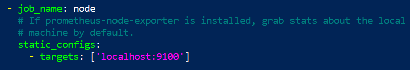

El node-exporter está instalado en la misma máquina de Prometheus.

Desde el navegador:

Prometheus: http://192.168.0.50:9090

Prometheus-Node-Exporter: http://192.168.0.50:9100

Grafana: [http://192.168.0.50:3000](http://192.168.0.50:3000)

Aquí configuramos Datasource con Prometheus y le ponemos la IP donde se encuentra Prometheus.

~~~text
1.- Instalación de mariadb
~~~

Hemos elegido trabajar con  mariadb.

~~~bash
apt update
apt install mariadb-server
systemctl status mariadb
~~~

Vamos a lanzar un script de seguridad (configuración de seguridad inicial)

~~~bash
mariadb-secure-installation
~~~

## 1.- Enter current password for root (enter for none): Enter

2.- Switch to unix_socket authentication [Y/n]: Y

Significa que el usuario del sistema operativo puede iniciar sesión en MariaDB sin contraseña, pero solo desde la misma máquina.

Remotamente, me pediría contraseña, pero como hemos desactivado remotely, tampoco.

3.- Change the root password? [Y/n]: Y  Ponemos contraseña peque

4.- Remove anonymous users? [Y/n]: Y

5.- Disallow root login remotely? [Y/n]: Y

6. Remove test database and access to it? [Y/n]: N

7.- Reload privilege tables now? [Y/n]: Y

Vamos acceder a mariadb:

mariadb –u root –p

[ Estamos entrando como el usuario root de mariadb, por eso me pide la contraseña. Si queremos entrar como root de la máquina, basta con poner mariadb]

Algunos comandos básicos:

SHOW DATABASES;

| 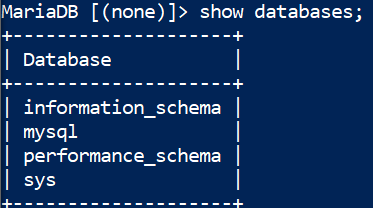 | Limpiar la pantalla: CTRL+L ó \! clear |
| --- | --- |

USE nombre_base_datos; (mysql)

SHOW TABLES;

DESCRIBE nombre_tabla;  user

SELECT User, Host FROM mysql.user;

| 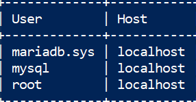 | 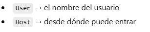 |
| --- | --- |

Ver los permisos que tiene un usuario en la base de datos:

SHOW GRANTS FOR 'nombre_usuario'@'localhost';

Ejemplo:

SHOW GRANTS FOR 'root'@'localhost';

| 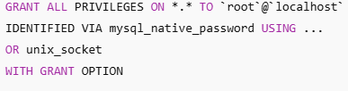 | Root tiene todos los permisos en todas las bases y tablas. Puede dar permisos a otros usuarios. |
| --- | --- |

Exit

~~~text
2.- Creación de un usuario para instalar mysqld_exporter
~~~

Es un usuario dentro de mariaDB

CREATE USER 'exporter'@'%' IDENTIFIED BY 'CAMBIAR_CONTRASENA_EXPORTER' WITH MAX_USER_CONNECTIONS 3;

GRANT PROCESS, REPLICATION CLIENT, SELECT ON *.* TO 'exporter'@'%';

# Comando extra para mariadb

GRANT SLAVE MONITOR ON *.* TO 'exporter'@'%';

FLUSH PRIVILEGES;

#### Resumen completo de la configuración:

- Crear un usuario: Se crea un usuario exporter con acceso desde cualquier host ('%'), usando la contraseña pass123, y con un límite de 3 conexiones simultáneas.
- Asignar permisos: El usuario exporter obtiene los permisos necesarios para:
- Ver los procesos en ejecución (PROCESS).
- Ver el estado de la replicación (REPLICATION CLIENT).
- Realizar consultas SELECT en todas las bases de datos para obtener métricas del sistema (SELECT ON *.*).
- Permiso de monitoreo de esclavos: Si estás utilizando replicación en MySQL, el permiso SLAVE MONITOR permite al usuario obtener métricas sobre los esclavos en un entorno de replicación.
- Aplicar cambios: El comando FLUSH PRIVILEGES asegura que los cambios en los permisos se apliquen correctamente.

Verificamos que todo ha ido bien:

SELECT User, Host FROM mysql.user;  Buscamos el usuario: exporter

SHOW GRANTS FOR 'exporter'@'%';

mysql -u exporter –p  pass123

~~~text
3.- Instalación de mysqld_exporter
~~~

~~~text

Monitorizar bases de datos MySQL con Prometheus y Grafana

Existe ya una librería de Prometheus llamada: prometheus-mysqld-exporter que extrae métricas detalladas de MySQL, como estadísticas de rendimiento, uso de recursos, conexiones, transacciones, consultas lentas, etc.

Pero, para ver otro procedimiento, nos lo vamos a bajar desde github.
~~~

1) Descargar el exporter oficial

cd /tmp

~~~bash
wget [https://github.com/prometheus/mysqld_exporter/releases/download/v0.18.0/mysqld_exporter-0.18.0.linux-amd64.tar.gz](https://github.com/prometheus/mysqld_exporter/releases/download/v0.18.0/mysqld_exporter-0.18.0.linux-amd64.tar.gz)
~~~

2) Descomprimir y mover el binario

tar -xvzf mysqld_exporter-0.18.0.linux-amd64.tar.gz

cd mysqld_exporter-0.18.0.linux-amd64

mv mysqld_exporter /usr/local/bin/

Comprobar versión:

mysqld_exporter --version

3) Crear usuario del sistema para el exporter

useradd -rs /bin/false mysqld_exporter

mkdir -p /etc/mysqld_exporter

Es un usuario que necesita el exporter.

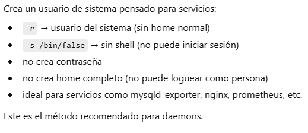

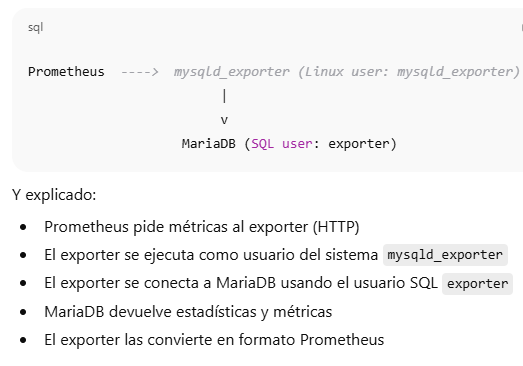

## 4.- Crear archivo de credenciales

nano /etc/mysqld_exporter/.my.cnf

Contenido:

[client]

user=exporter

password=CAMBIAR_CONTRASENA_EXPORTER

Permisos:

chown mysqld_exporter:mysqld_exporter /etc/mysqld_exporter/.my.cnf

chmod 600 /etc/mysqld_exporter/.my.cnf

5) Comprobar conexión con MariaDB

mysql --defaults-file=/etc/mysqld_exporter/.my.cnf -e "SHOW DATABASES;"

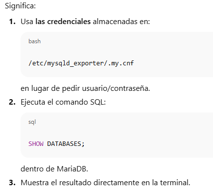

6) Comprobamos que todo está bien:

mysqld_exporter --config.my-cnf=/etc/mysqld_exporter/.my.cnf

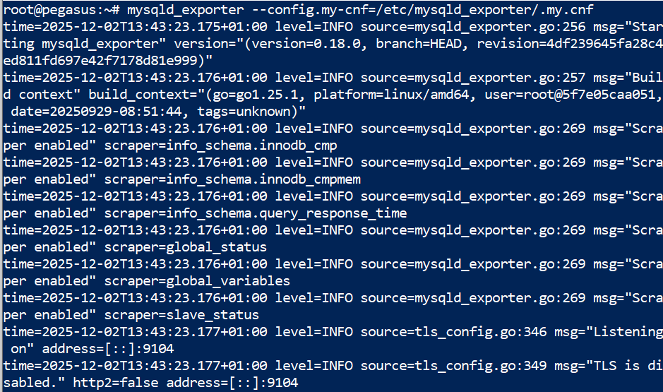

Hay que dejarlo lanzado

OPCIONAL:

Desde otro terminal:

~~~bash
curl –s http://localhost:9104/metrics | head
~~~

-s: De forma silenciosa

~~~text
4.- Configurar prometheus para scrapear MariaDB
~~~

Ahora tenemos que configurar Prometheus para que lea las métricas que le proporciona mysqld_exporter.

/etc/prometheus/prometheus.yml

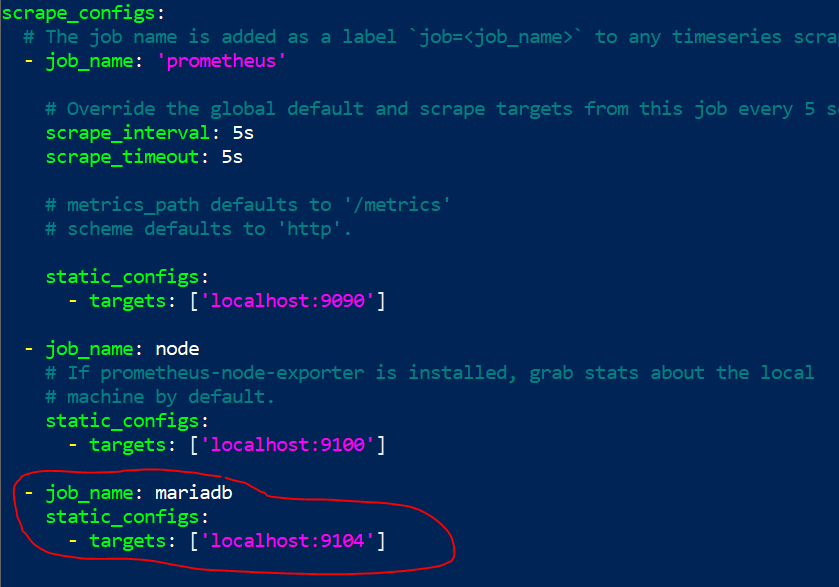

localhost: Indica que el servicio (en este caso mariadb y node) está ejecutándose en el mismo servidor donde está Prometheus.

9100 y 9104: Es el puerto donde node exporter y mysqld_exporter expone las métricas en formato compatible con Prometheus.

Prometheus necesita saber el endpoint (objetivo): La URL donde están expuestas las métricas (por ejemplo, localhost:9104).

Comprobamos la sintaxis: Promtool es una herramienta de Prometheus

~~~bash
promtool check config /etc/prometheus/prometheus.yml
~~~

Reiniciamos Prometheus

~~~bash
systemctl restart prometheus
~~~

Comprobación: [http://192.168.0.51:9104](http://192.168.0.51:9104)  MYSQLD_EXPORTER

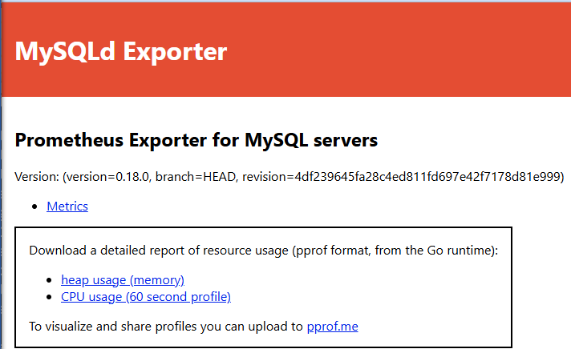

Pulsar en metrics

Comprobación: [http://192.168.0.51:9090](http://192.168.0.51:9090) PROMETHEUS

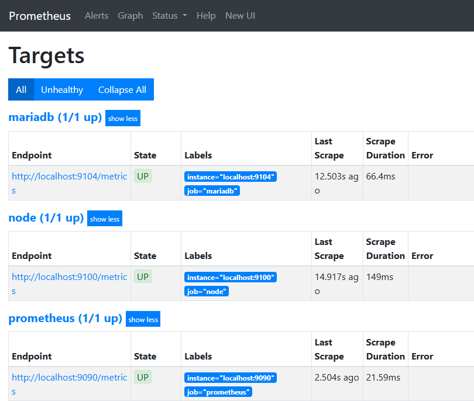

~~~text
5.- Configuración de Grafana
~~~

No hace falta seleccionar un nuevo Data Source.

Podemos crear nuestras propias consultas o bien utilizar un Dashboard creado.

Importamos un Dashboard:

[https://grafana.com/grafana/dashboards/](https://grafana.com/grafana/dashboards/)

Buscamos: mysql (También se podrían buscar otros)

Nos fijamos en: MySQL Overview

Copiamos el ID: 7362

Nos vamos a Grafana y lo importamos.

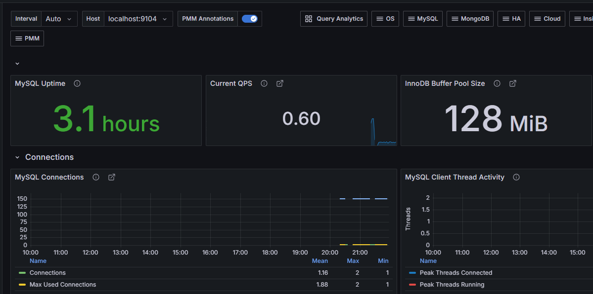

#### Resumen de los parámetros más importantes:

Conexiones activas: mysql_global_status_threads_connected

Consultas y rendimiento: mysql_global_status_queries, mysql_global_status_slow_queries

Rendimiento de InnoDB: mysql_innodb_buffer_pool_pages_dirty, mysql_innodb_buffer_pool_pages_total

Uso de recursos del sistema: system_cpu_usage, system_memory_usage

Tiempo de actividad: mysql_global_status_uptime

Replicación (si se aplica): mysql_slave_status_seconds_behind_master

InnoDB es uno de los motores de almacenamiento más utilizados en MySQL y MariaDB. Los motores de almacenamiento en bases de datos son responsables de cómo se almacenan, gestionan y acceden a los datos.

~~~text
6.- Prueba de estres
~~~

Desde el terminal del servidor:

mariadb –u root –p

SHOW DATABASES;

CREATE DATABASE testdb;

USE testdb;

SHOW TABLES;  No hay tablas.

Necesitamos crear una tabla para hacer las pruebas de estrés.

USE testdb;

CREAMOS UNA TABLA:

CREATE TABLE test_table (

id INT AUTO_INCREMENT PRIMARY KEY,

name VARCHAR(255) NOT NULL,

value INT NOT NULL

);

INTRODUCIMOS REGISTROS:

INSERT INTO test_table (name, value) VALUES ('Test1', 100), ('Test2', 200), ('Test3', 300);

COMPROBAMOS:

SELECT * FROM test_table;

Estrés con: mysqlslap

Hay que instalarlo:

~~~bash
apt install mariadb-client-compat
~~~

Comprobación:

which mysqlslap

mysqlslap --version

PRUEBA:

Se realizará una prueba de carga básica sobre la base de datos testdb utilizando el usuario root y la contraseña peque, con 1000 conexiones concurrentes y 1000 iteraciones. En este caso, estamos utilizando una consulta simple SELECT sobre la tabla test_table.

Probamos con 200 y subimos:

mysqlslap --user=root \

--password=CAMBIAR_CONTRASENA_EXPORTER \

--host=localhost \

--concurrency=200 \

--iterations=10 \

--query="SELECT * FROM test_table" \

--create-schema=testdb

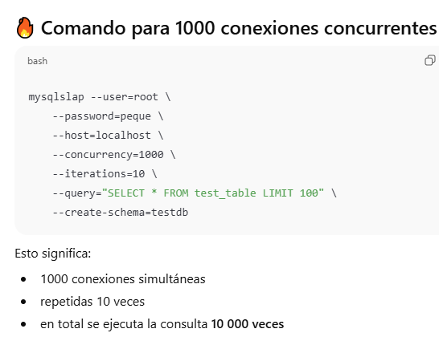

~~~text
GRAFANA
~~~

Observa los picos que se produce y analízalos.

Fíjate por ejemplo en:

Incrementará el número de consultas ejecutadas (mysql_global_status_com_select y mysql_global_status_questions).

Aumentará las conexiones activas al servidor (mysql_global_status_threads_connected).
